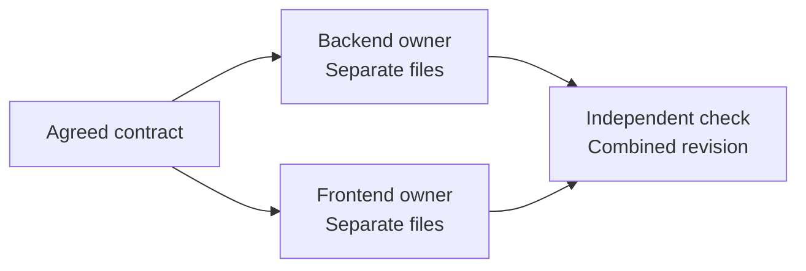

# Orchestration: use more agents only when it pays

This skill decides whether one agent or several should do the work, then checks ownership, hand-offs, and completion. Use it for explicit delegation, independent review, or work split across agents.

## Core concepts

- **One agent is the default.** Add agents for independent work or a useful independent review.
- **Capabilities follow the task.** Architecture, implementation, and verification do not need permanent agent roles.
- **Contracts precede dependent work.** Packages name their owner, allowed files, prerequisites, and acceptance checks.
- **Evidence decides.** A hand-off saying “tests pass” needs commands, results, and file fingerprints the receiver can check.

Parallel packages must not write the same files. Reviewers do not review their own work. Delegation, retries, and corrections have explicit bounds.

## Apply it

1. Describe the change and identify work that can proceed independently. Keep shared contracts ahead of their consumers.
2. Have the lead define and mechanically check the execution plan. For an unattended run, prove required tools, accounts, data, and escalation paths work before starting.
3. Check hand-offs against the actual files, integrate the work, and verify acceptance criteria on the final combined revision. The lead runs each check once there and keeps its output; reviewers read that output instead of running the same checks again.

Blocking findings need evidence of resolution or explicit human risk acceptance. The skill's workflow requires human approval before merging.

## Project example

An export feature needs a backend endpoint and a frontend screen. Agree on the response contract first. Then assign separate files to each package and give the integrated flow to a reviewer who wrote neither part. If both packages need to edit the same contract, sequence that work.

> `$alchemy-orchestrate` Plan backend and frontend export work after the response contract is agreed. Name file ownership and the final integration check.

[Full skill](../.claude/skills/alchemy-orchestrate/SKILL.md)

<!-- skill-revision: d7926dc57698 -->
