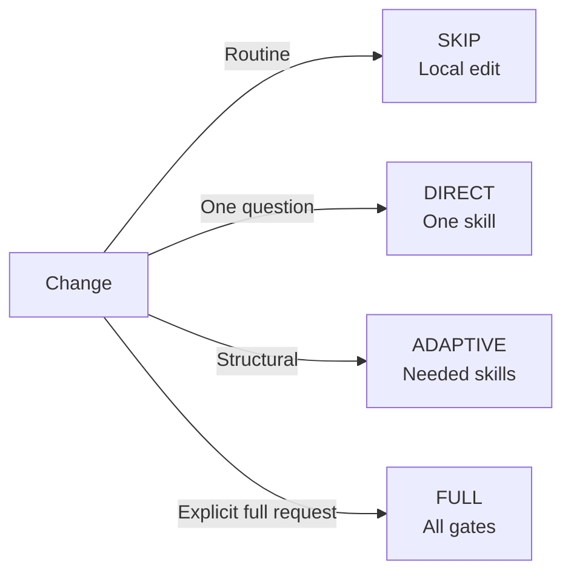

# Alchemy: choose the right amount of engineering

Alchemy routes a change to the engineering questions it needs, in the right order. Use it when you want help deciding which skills apply to a design, refactor, or audit.

## Core concepts

For structural work, establish the problem and its worth before designing. Then check readiness, design the boundaries, measure complexity, enforce the rules, and place defect checks. Optimize in a later iteration, after the change ships and has a measured baseline.

A subsystem is where change lands; an increment is what changes. An aspect is one obligation and mechanism spanning subsystems. An iteration delivers and measures an increment.

## Apply it

1. Name the change, affected area, and intended result. Say whether you want advice, implementation, or an audit.
2. Invoke `$alchemy` in Codex or `/alchemy` in Claude Code. The dispatcher selects the route before loading deeper guidance.
3. Continue from existing decisions when they remain valid. Reopen the specific failed question when new evidence contradicts one.

An audit starts by measuring the current structure without changing it. Several selected skills do not automatically require several agents.

## Project example

You want to extract billing logic from checkout. Alchemy checks whether the extraction is worthwhile, whether the work is ready, where billing belongs, and whether the proposed structure improves complexity. Agreed dependency rules ship with the change. A copy edit takes the SKIP route.

> `$alchemy` Review extracting billing from `checkout/`. Keep the scope to this boundary and reuse existing requirement decisions.

[Full skill](../.claude/skills/alchemy/SKILL.md) · [Detailed diagram](design_and_refactor.svg)

<!-- skill-revision: f425c60ee1ea -->
