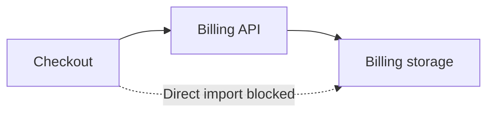

# Architecture as code: make dependency rules executable

Architecture as code turns agreed dependency boundaries into checks that fail on forbidden imports. Use it when adding or repairing boundary enforcement in a JavaScript, TypeScript, or Python project.

## Core concepts

- **Classify the source.** Map files or packages to named subsystems. Unclassified or excluded code can escape enforcement.
- **Put rules with their owner.** A subsystem declares its internals and outbound constraints. Its parent declares relationships between siblings and who may call them.
- **Assemble one configuration.** Small local declarations feed the import checker; generated configuration is not edited by hand.
- **Know the limits.** Static imports reveal static dependencies. Runtime dispatch and shared data need separate evidence.

JavaScript and TypeScript use `eslint.architecture.mjs` declarations assembled into ESLint flat-config. Python uses `architecture.toml` declarations assembled into import-linter contracts.

## Apply it

1. Agree on the public interfaces and forbidden dependencies before encoding rules.
2. Add the declarations with the governed code. Include the whole source tree, check classification coverage, and configure aliases so imports resolve.
3. Introduce a deliberate forbidden import. Confirm the actual project configuration rejects it for the expected reason, then remove it and run the clean check.

Computed imports need an explicit policy because a static checker may not see their targets. A passing lint run proves only the constraints it actually evaluated.

## Project example

Billing may expose `billing/api`, while its calculation and storage internals stay private. The parent configuration permits checkout to use that API and rejects direct imports of `billing/storage`. A deliberate storage import proves the restriction works.

> `$architecture-as-code` Enforce billing's public API in this TypeScript repo. Check source coverage and prove a forbidden import fails.

[Full skill](../.claude/skills/architecture-as-code/SKILL.md) · [Detailed diagram](architecture_as_code.svg)

<!-- skill-revision: e7d479c23c56 -->
