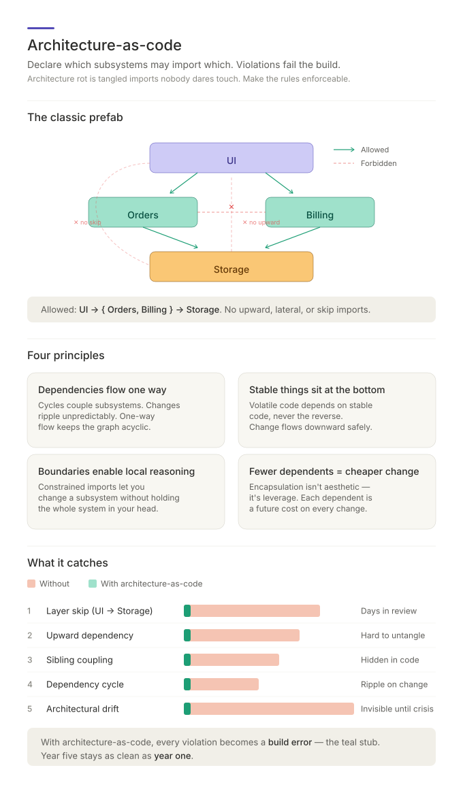

# Architecture-as-Code: Rules the Build Can Refuse

The team agrees, in a well-attended meeting, that domain logic must not
import infrastructure code. It goes in the architecture decision record.
Everyone nods.

Four months later, a grep finds eleven violations. Nobody rebelled — the
rule was simply invisible at the moment it mattered: 4:45pm, a deadline, an
autocompleted import that worked. Each violation made the next one look
normal. The decision record was never wrong; it was just *unenforced*, and
an unenforced architectural rule is a suggestion with a half-life.

This document explains architecture-as-code: the idea that a system's
dependency rules should live in version-controlled files that a linter
enforces on every commit — so the architecture *is* checked, the way types
and tests are, rather than remembered. Two sections near the end show how the
idea lands in JavaScript/TypeScript and in Python, the two stacks the skill
ships an implementation for.

## The enforceable subset of architecture

Not everything called "architecture" can be automated. What *can* be —
completely, cheaply, deterministically — is the **import graph**: which
subsystems are allowed to depend on which. That subset is worth automating
because most architectural erosion is exactly this: dependency arrows
appearing where the design says none should exist. Layer skips, domain
logic reaching into infrastructure, two sibling features quietly importing
each other's internals — every one of them is just an edge in the import
graph, and machines are excellent at checking edges.

The recipe has three ingredients:

1. **Name the subsystems.** Declare that files under `billing/` are the
   `billing` subsystem, that `core/facade.ts` is the `core-facade`, and so
   on — patterns mapping the directory tree onto named subsystems.
2. **Declare the forbidden edges.** `domain` may not import
   `infrastructure`. Nobody but the `orchestrator` may import
   `core-facade`. Sibling feature subsystems may not import each other.
3. **Check every commit.** An import-graph linter (they exist for every
   major ecosystem) evaluates the actual imports against the declared
   rules and fails the build on violation.

The 4:45pm import now fails *in the editor*, seconds after being typed,
with a message explaining the rule — which is why every rule carries a
**why**: the violation message is the architecture teaching itself to
whoever bumps into it, precisely at the moment they're making the mistake.
No meeting, no memory, no code-review vigilance required.

## The design discipline: who is allowed to know what

The naive version of this idea is one giant rules file at the repo root —
and it rots just like any other centralized registry: every subsystem change
edits the same file, the file grows into an unreadable tangle, and after a
while nobody knows which rules still reflect intent. The pattern that
scales rests on a principle worth knowing beyond this context, because
it's the same principle that makes subsystems themselves work:

> **A subsystem may know itself. It may not know its context.**

Concretely, every subsystem (directory) may carry its own small architecture
file, and that file may declare only two kinds of things:

- **Its internals** — the subsystems it contains and their layering: "my tier-3
  code may not reach directly into my tier-1 code."
- **Its outbound rules** — what *it* imports: "core imports nothing outside
  core."

What a subsystem's own file may *never* declare is anything requiring
knowledge of the wider world: who is allowed to import it, how it relates
to siblings, its place in the system. Those are **composition** questions,
and they live one level up — in the architecture file of the directory
that composes the subsystems together. "Only the orchestrator may import the
core facade" is knowledge about how the composer arranged its subsystems, so
the composer's file says it.

The mechanical tell is memorable: *a subsystem's own architecture file never
contains another subsystem's name.* The moment it does, knowledge is leaking
across a boundary — the same smell as a class hardcoding its callers'
names, appearing one level up.

An assembler script walks the tree, gathers every architecture file, and
merges them into one configuration for the linter. Two conventions do
disproportionate work here. **Wildcards over enumerations**: writing "any
subsystem except the orchestrator" as `* except orchestrator` rather than
listing subsystems means new subsystems are governed the moment they're created,
instead of silently ungoverned until someone remembers the list. And a
**catch-all pattern last in every governed subsystem**: any file matching no
declared subsystem is *invisible* to the linter, and invisible files bypass
every rule — the catch-all closes the gap that would otherwise make the
whole system quietly optional. The merged linter config itself is a build
artifact — generated, git-ignored, never hand-edited; the per-subsystem files
are the single source of truth.

## The two ways coverage fails quietly

Naming the subsystems is only the first of two gates, and the second is the
one that gets missed: the rule also has a *scope* — the set of files the
linter runs it against. A registry that classifies every file in the
repository still enforces nothing on a path the rule never visits. Teams
narrow that scope for ordinary reasons ("lint the packages directory"), it
drifts into a hand-maintained allowlist, and one day a new top-level
directory lands outside it. Thousands of lines, a public deployment, and a
boundary lint reporting zero violations — because zero is also what it
reports when the question is never asked. The rule's scope must be the whole
source tree, and the exclusions must live somewhere a reviewer sees them.

The second failure is subtler, and it is the catch-all advice above turning
against itself. Most import-graph linters match a pattern against a file's
parent *folders* rather than its full path, which means a `**` catch-all
matches at the shallowest folder and claims files that more specific
subsystems already own — no matter how far down the list it sits. Inside a
subsystem, where the declared subsystems sit at one depth, the catch-all does
what it promises. At the repository root it swallows everything. The root's
loose files need to be declared as exact files, one by one.

Both failures share a signature worth recognizing anywhere: the tool's only
signal is a number that stays at zero, and a green check reads the same
whether the boundary held or was never tested. The defense is to ask for a
positive signal instead — *how many files did the rule actually classify, and
does that match how many files exist?* — and to turn on the rule that fails
on unclassified files, so a file with no imports at all cannot slip through
the gap between "no forbidden edge found" and "no edge was ever examined."

## Rules before code

A timing rule with an outsized effect: when creating a new subsystem, write
its architecture file **before** its implementation, in the same change.

The reasoning is about what each ordering produces. Rules-first means the
very first wrong import fails immediately — the boundary is real from day
one, and the subsystem grows inside it. Rules-later means the rules are
written to describe whatever dependencies have already accumulated — and
retrofitted rules face an ugly pair of options: rubber-stamp the accidents
(making the "architecture" a photograph of the mess) or declare war on
them (an unbounded refactor nobody scheduled). Ten minutes of declaration
before the first line of code buys years of a boundary that was never
crossed.

Honest exception: genuine throwaway spikes may skip rules — exploration
shouldn't fight scaffolding. The condition is that spike code never
crosses into the main branch ungoverned; it gets deleted, or rewritten
rules-first. "We'll add the rules later" is how permanent subsystems end up
permanently ungoverned.

## What this pattern is not

Three boundaries keep the idea honest:

- **It doesn't decide what the architecture should be.** Which boundaries
  exist, which direction dependencies flow — those decisions come from
  design principles and evidence, elsewhere. This pattern is the
  *enforcement layer*: it takes a decided constraint and makes it
  physically checkable. Encoding a bad architecture enforces a bad
  architecture, very reliably.
- **It sees only static imports.** Coupling that flows through runtime
  indirection — event buses, registries, dynamically-computed imports — is
  invisible to import analysis. That's a reason to prefer static, resolvable
  imports where possible, and to know explicitly which couplings the
  linter does *not* see, so nobody mistakes "the architecture lint passes"
  for "the architecture holds."
- **It replaces prose ADRs' enforcement, not their rationale.** The
  decision record still explains *why* the boundary exists; the rule makes
  it *hold*. One is for humans deciding whether to change the rule; the
  other is for the build refusing to let it erode by accident.

## In JavaScript and TypeScript: what the linter can see

ESLint normally checks code one file at a time — style, syntax, suspicious
patterns. But every `import` statement names a path, and a resolver can
turn that path into a concrete file. That's enough to reconstruct the
import graph. Boundary plugins (the established one is
`eslint-plugin-boundaries`) build on exactly this:

1. **Classification.** Glob patterns map files to named subsystems:
   everything under `packages/core/tier1/**` is `core-tier1`;
   `packages/core/index.js` alone is the `core-facade`. Patterns are matched
   in order, narrowest first — the facade's exact file path before tier
   directories before the catch-all — so each file lands in its most
   specific classification.
2. **Rules over pairs.** Each rule forbids edges between subsystems:
   *`core-*` may import nothing outside `core-*`*; *nobody but the
   orchestrator may import `core-facade`*.
3. **Evaluation per import.** For every import in every file, the plugin
   resolves the target, classifies both ends, and checks the pair against
   the rules. A match on a forbidden edge is a lint error, in the editor
   and in CI.

The per-subsystem rule files are named `eslint.architecture.mjs`, and the
assembler merges them at lint startup into one ESLint flat-config.

Both quiet coverage failures above have a concrete JavaScript form. The scope
gate is the `files` glob of the flat-config block that holds the boundaries
rule: a scope that started as `packages/**` and grew into a hand-kept list of
directories will eventually miss a new one. Point the block at the whole tree
and keep real exclusions in the config's shared ignore list, where they are
one visible list rather than an omission. The rule that fails on unclassified
files is the plugin's unknown-file rule.

Two more failures are specific to how JavaScript names its imports, and they
produce the same dangerous symptom: a green lint run that isn't checking what
you think it checks.

**Unresolved imports are invisible.** The plugin can only judge an import it
can resolve to a file. An import path the resolver doesn't understand — a
host-served absolute path like `/js/app.js`, an exotic alias, a
bundler-specific scheme — resolves to nothing, gets classified as nothing,
and passes every rule *silently*. The fix is configuring the resolver (e.g.
an alias resolver mapping `/js` to its real directory) so every real
dependency is visible. The test: if you can't jump-to-definition through an
import, the linter probably can't follow it either.

**Computed dynamic imports are invisible.** `import('./' + name)` can't be
resolved statically — the target is decided at runtime, so the boundary
plugin can't see the edge at all. One computed import can smuggle any
dependency past every rule. The countermeasure is a companion lint rule that
forbids non-literal dynamic import paths outright:
`import('./known-module.js')` is fine; variables, concatenation, and
template strings in an import are themselves the lint error. This isn't
pedantry — it's closing the one door the whole enforcement scheme can't
watch.

The principle behind both: **static enforcement governs only the statically
analyzable.** Every convenience that makes imports more "dynamic" trades away
the ability to check them.

Ecosystem idioms worth knowing:

- **Facade as a single file.** JavaScript's natural public-API idiom is an
  index/entry file. Declaring it as a single-file subsystem (exact path,
  `mode: 'file'`, no glob) lets rules like "outsiders may import the
  facade and nothing else in the subsystem" match precisely.
- **Test/production separation.** Declare test files
  (`src/**/*.test.ts`, `test/**`) as their own subsystems *before* the
  production catch-all, then forbid the production subsystem from
  importing them. One direction only: tests may import production code;
  production importing test code is the bug.
- **`.mjs` for the rule files.** The architecture files are ES modules the
  assembler `import()`s at startup. Naming them `.js` gets them
  misclassified as application source by discovery walkers and by ESLint
  itself; the `.mjs` extension keeps them out of their own jurisdiction.
- **Errors from day one; narrow the scope for legacy.** A newly-introduced
  rule on an old codebase surfaces existing violations, and the reflex is to
  run it at `warn` until the backlog clears. Don't: a rule at `warn` is a
  report, not a boundary — the build stays green while the edge it forbids
  ships. Register it at `error`, and if the repository cannot pass yet,
  narrow the rule's scope through declared subsystems (declare the legacy
  area as its own subsystem and allow only the edges it already has), never
  by softening the severity. The debt then sits in the architecture file
  where a review can see it shrink.

## In Python: contracts over the import graph

Python will happily let any module import any other module. `from
mypkg.core.internals import _do_things` works from anywhere — the
underscore is a social convention, not a wall. The language itself offers
nothing to hold the line; the ecosystem does, in two layers. A graph builder
(**Grimp**) imports your root package and walks every module's `import` and
`from ... import` statements, producing the complete static import graph —
every edge from every module to every module it names. A contract checker
(**import-linter**) evaluates declared rules against that graph and exits
non-zero on violation, which is what makes it a pre-commit hook and CI gate.

Rules address modules by their dotted paths, and a path matches the package
*and everything under it* by default — `mypkg.core.tier1` covers the whole
subtree, which is usually what a boundary means. Three contract shapes
cover nearly everything:

- **Forbidden** — the workhorse: modules in set A may not import modules in
  set B. "Core purity: `mypkg.core` imports nothing outside itself."
- **Independence** — N sibling packages may not import each other at all.
  One contract replaces N×(N−1) forbidden edges — the natural shape for
  "feature subsystems stay isolated."
- **Layers** — a strict ordering: `api` above `domain` above `storage`;
  higher may import lower, never the reverse. The whole layered
  architecture in one declaration.

Each governed package carries a plain-TOML `architecture.toml` naming its own
subsystems and outbound rules; the assembler discovers them all, expands the
wildcards, and generates the import-linter config.

**The facade is a public sub-package.** Every language grows its own shape
for "this is the public API; the rest is internal." Python's is the
sub-package: `mypkg.core.api` exposes the public surface through its
`__init__.py` (with `__all__` naming the official exports), while
`mypkg.core.tier1`, `mypkg.core.engine`, and the rest are implementation.
The contracts then make the convention real: outsiders may import
`mypkg.core.api` and are *forbidden* from importing the internal
sub-packages directly. The underscore prefix asks nicely; the contract
refuses the merge. This is the single most valuable rule pair in most Python
codebases, because it's the difference between "we can refactor core's
internals freely" being true and being folklore.

Python has its own well-known blind spots:

**Dynamic imports.** `importlib.import_module(name)`, `__import__`, and
string-based plugin dispatch never appear in the graph — the module name
is computed at runtime. One dynamic import can carry any dependency past
every contract, invisibly. The pragmatic posture: confine dynamic loading
to one explicitly-declared entry-point module whose rules are written with
that in mind, and keep the style banned everywhere else. A plugin system
gets one well-lit door, not a building with no walls.

**The environment matters.** The graph builder *imports your package to
analyze it* — so the checker runs inside the project's virtualenv, with
the package installed (`pip install -e .`). Run it outside that
environment and it fails — or worse, analyzes a stale installed copy
rather than your working tree. The related trap is the analyzer's cache:
excellent for speed, misleading mid-refactor. When violations don't match
what the import statements plainly say, delete the cache before doubting
your eyes.

**Wildcard semantics.** In raw import-linter patterns, `mypkg.*` matches
one level only — `mypkg.foo` but *not* `mypkg.foo.bar`. Meanwhile the
assembler's subsystem-name wildcards (`core-*`) expand across subsystem
names before contracts are generated, with no such limit. Two wildcard
systems, different rules; mixing them in one rule produces contracts that
check less than they appear to. When a contract seems to pass suspiciously
easily, this is the first thing to check.

## The habit

The concept compresses into a question to ask about any architectural
agreement your team makes: *"what enforces this?"* If the answer is
"review vigilance and the wiki," you have a suggestion, and its half-life
started at the meeting. If a dependency rule can be stated as "X may not
import Y" — and most can — it can be a build failure instead. Declared
where the knowledge belongs, worded with its reason, checked on every
commit: that is an architecture that stays the way it was designed, not
because everyone remembers, but because nothing that violates it can
merge.

Working in a repository governed this way asks for one more reflex. When the
checker blocks an import, read the `why` message before reaching for a
workaround — the rule is a design decision talking to you. The correct
responses are "route through the public interface" or "challenge the rule in
review". The response that defeats the whole mechanism is the workaround
import — a path the resolver can't see, dynamic loading, a re-export shim —
that satisfies the letter of the rule while smuggling the dependency anyway.
The graph the checker sees should *be* the architecture, not a sanitized
version of it.

---

*Related concepts:
[architecture guidelines](READ-architecture-guidelines.md) and
[morphogenetic architecture](READ-morphogenetic-architecture.md) decide
which boundaries and directions the rules should encode;
[shift-left](READ-defect-shift-left.md) explains why enforcement belongs in
the editor and the build rather than in review — this pattern is its
"decision record → executable rule" move made systematic. The full
operational reference — file schema, rule placement, and audit checklist —
lives in [SKILL.md](../.claude/skills/architecture-as-code/SKILL.md); the
assembler pipeline, needed only to build or change one, lives in
[assembler.md](../.claude/skills/architecture-as-code/references/assembler.md).
The stack implementations load only when their stack is in play: the
JavaScript/TypeScript file format, recipes, and gotchas in
[javascript.md](../.claude/skills/architecture-as-code/references/javascript.md),
with the assembler code, needed only to set up or change `eslint.config.js`,
in
[javascript-assembler.md](../.claude/skills/architecture-as-code/references/javascript-assembler.md);
the Python file format, contract types, assembler code, and gotchas in
[python.md](../.claude/skills/architecture-as-code/references/python.md).*

<!-- skill-revision: e7d479c23c56 -->
