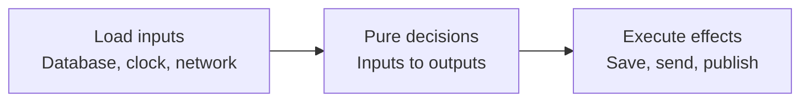

# Architecture guidelines: design code that is cheap to change

This skill shapes subsystems, interfaces, and integrations. Use it when introducing an abstraction, designing a service, or changing responsibilities across boundaries.

## Core concepts

- **Contain change.** Give each subsystem one coherent responsibility and a small public interface. Callers should not depend on its implementation.
- **Keep decisions pure.** Business logic takes inputs and returns decisions. Database access, clocks, and network calls live at the edges.
- **Keep dependencies directed and acyclic.** Avoid forwarding layers that add no policy or isolation.
- **Build only what is needed.** Share business knowledge, but wait for concrete repeated needs before inventing a general abstraction.
- **Design failure behavior.** Decide which calls must succeed, which are best-effort, and whether partial completion is acceptable. Controls must hold at their own layer.

Across applications, publish explicit contracts. Keep validation and transformation at owned endpoints; let transport carry messages. Consumers translate external data into their own model.

## Apply it

1. Name the responsibility, callers, public operations, and dependencies. Read the existing interface and nearby callers before extending it.
2. Separate pure decisions from effects. For each external interaction, define failure handling and retry safety.
3. Review whether the design can change internally without changing its callers. Turn enforceable dependency decisions into architecture rules.

## Project example

An invoice calculator receives line items, tax rules, and the invoice date. It returns totals without querying a database or reading the clock. An application operation loads those inputs, calls the calculator, and saves the result. Calculation tests use ordinary values rather than database mocks.

> `$architecture-guidelines` Review the invoice subsystem's responsibility, public interface, pure logic, and failure behavior.

[Full skill](../.claude/skills/architecture-guidelines/SKILL.md) · [Detailed diagram](architecture_guidelines.svg)

<!-- skill-revision: 90e511ecdde9 -->
