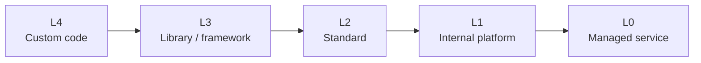

# Bring-down: maintain less commodity code

Bring-down replaces bespoke capability with a suitable framework feature, approved library, standard, internal platform, or managed service. Use it when your team owns code that many other products also need.

## Core concepts

The capability is valuable; its implementation carries maintenance cost. Keep product-specific rules local. Move stable, commodity behavior to the lowest responsible maintenance level:

These are maintenance levels, not required migration steps or application layers. Moving a helper to another directory does not transfer maintenance. Lower is useful only when the capability still fits your requirements.

## Apply it

1. Confirm the capability is still needed. Delete obsolete behavior rather than replacing it.
2. Look first in the existing framework, then approved dependencies and internal platforms. Consider new providers only when those do not fit.
3. Compare behavior, maintenance, security, license, cost, migration, and exit options. Move callers, verify the required behavior, and delete the old implementation.

A wrapper earns its cost when it enforces real policy. A wrapper that only renames another API adds code to maintain. Similar-looking implementations also need genuinely shared semantics before consolidation.

## Project example

Three services each maintain retry code. Their HTTP library already supports the required retry limit and backoff. Configure that feature, check timeout and duplicate-request behavior, migrate the callers, and remove the custom loops. Keep any product-specific retry decision explicit.

> `$bring-down` Check whether our custom HTTP retry helper can use capabilities already in this stack. Include migration and deletion of the old path.

[Full skill](../.claude/skills/bring-down/SKILL.md)

<!-- skill-revision: 468c9e5403d9 -->
