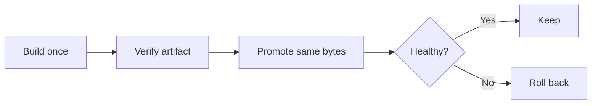

# Reliable CI/CD: deploy safely and recover predictably

This skill designs pipelines that survive retries and partial failures. Use it when creating, reviewing, or debugging build, release, and deployment workflows.

## Core concepts

- **Idempotent steps:** repeating a step converges on the intended state without duplicating effects.
- **Explicit contracts:** jobs declare inputs, outputs, tools, timeouts, and failure behavior.
- **Immutable artifacts:** build once and promote the same bytes through environments. Inject environment configuration at deployment.
- **Bounded recovery:** retry transient faults; fail clearly on permanent ones. Failed health checks trigger the defined rollback.
- **Safe transition:** prepare the replacement, verify it, switch traffic, and drain old requests. Old and new code must remain data-compatible.
- **Minimal credentials:** prefer short-lived federated identity; keep necessary secrets in managed storage.

Promotion requires evidence about the artifact, configuration, migration, health, and recovery path. A successful deployment command alone does not prove the service works.

## Apply it

1. Walk through failure halfway through every step. Make retries safe and remove assumptions about files or state left on a runner.
2. Identify artifacts by immutable identity and retain known-good promoted versions for rollback. Preview infrastructure changes before mutation, especially destructive data-resource changes.
3. Define health thresholds, a verification window, and the rollback action. Rehearse the failure path before relying on it.

## Project example

Build a container once and record its digest. Deploy that digest to staging, verify it, then promote the same digest to production. If the rollout breaches its health threshold, restore the previous digest. Keep schema changes compatible so the previous application still runs.

> `$ci-cd-reliability-architecture` Review our deployment workflow for retry safety, artifact identity, health verification, and rollback.

[Full skill](../.claude/skills/ci-cd-reliability-architecture/SKILL.md) · [Detailed diagram](cicd_reliability.svg)

<!-- skill-revision: 00f769703de4 -->
