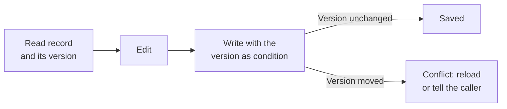

# Concurrency control: say how each shared record takes its writes

This skill decides, for every record that more than one writer can reach, how its writes are serialized so that concurrent saves, retries, and replays cannot lose an update. Use it when users, tabs, workers, or instances write one record; when a save reads, modifies, then writes; when a request can be retried; or when a lost update or race is reported.

## Core concepts

- **One write model per record.** Version check, single writer, idempotency key, commutative merge, or ordered start-up. Last-writer-wins is not a model: it is a lost update with a timestamp.
- **The store enforces the model.** The condition travels with the write: an ETag in `If-Match`, a row version in the `WHERE` clause, a unique key, a fencing token. A check in application code between the read and the write is a race.
- **A conflict is an answer.** A rejected write returns a result the caller can act on. Retrying it unchanged, or overwriting to make it pass, brings the lost update back.
- **The losing schedule is the oracle.** Two writers from one version, a lease lost mid-job, a replayed request, a save before load completes. A test with one writer proves nothing about two.

## Apply it

1. List every writer of each record the change touches, retries and background jobs included.
2. Pick the write model and name the store mechanism that enforces it.
3. Say what the caller sees when its write loses, and prove the losing schedule with an interleaving test against the real store or its emulator.

## Project example

Two planners edit the same plan document; the save endpoint reads it, applies the edit, and replaces it, so the later save silently erases the earlier one. A nightly totals job also ran on two instances after a scale-out. The record gets a version check with the document's ETag, the job gets a lease with a fencing token, and the client's retry on timeout carries an idempotency key.

> `$concurrency-control` Our plan save loses edits when two people work at once, and the nightly job ran twice. Declare the write model for each writer.

[Full skill](../.claude/skills/concurrency-control/SKILL.md)

<!-- skill-revision: 30792d3c69f5 -->
