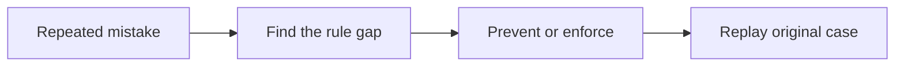

# Continuous improvement: fix the cause of repeat mistakes

This skill turns recurring failures and user feedback into better agent instructions or automated safeguards. Use it when the same correction keeps appearing, or when an existing skill leads to the wrong behavior.

## Core concepts

Fixing an instance restores the immediate result. Fixing the rule changes what happens next time. Diagnose the gap before adding another instruction:

- **Missing:** no rule covered the case.
- **Ambiguous:** the wording allowed competing readings.
- **Conflicting:** two instructions pointed in different directions.
- **Ignored:** the rule was hard to find or lacked enforcement.
- **Misunderstood:** assumptions about the system were wrong.

Prefer prevention through types or schemas, then automatic checks, then guidance at the point of use. Use prose when the judgment cannot be encoded. Each rule needs one authoritative home.

## Apply it

1. Capture the concrete failure and identify the instruction or system behavior that allowed it. Check whether it is a recurring pattern rather than a one-off slip.
2. Make the smallest durable correction. Tighten or replace existing guidance before adding more. Put reusable agent behavior in the owning skill.
3. Replay the original case and check that the correction prevents it without blocking valid work. Tell affected users what changed.

## Project example

An agent repeatedly reads the clock inside invoice calculations despite a purity guideline. If an enforceable dependency check can catch that access, add it and prove the old code fails. If the problem is unclear skill wording, replace the vague rule with a concrete input/output example and replay the task.

> `$continuous-improvement` This agent keeps mixing database access into pure calculations. Find the rule gap and make the smallest reusable correction.

[Full skill](../.claude/skills/continuous-improvement/SKILL.md) · [Detailed diagram](continuous_improvement.svg)

<!-- skill-revision: 196421159ee5 -->
