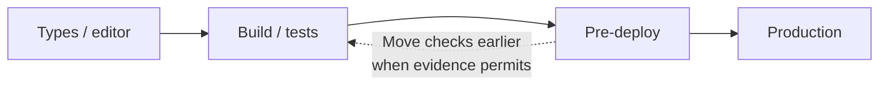

# Shift-left: catch defects at the earliest capable stage

Shift-left places each defect check where the required information first exists. Use it after an escaped bug, when adding a check, or when reviewing a delivery pipeline.

## Core concepts

The timeline runs from design and editing through build, tests, deployment, and production. Earlier feedback usually reduces rework and limits who is affected, but a check can move only as early as its evidence permits.

- **Prevent first.** Types and schemas can make invalid states unrepresentable.
- **Detect next.** Use editor, build, or test checks when the defect can be observed there.
- **Block progression.** A detected violation must stop the relevant commit, merge, or deployment.
- **Preserve distinct coverage.** Remove a later duplicate only after proving the earlier check covers it. Keep later checks that see broader scope or different conditions.

A schema can generate static types and runtime validators, keeping several stages aligned without separately maintained definitions. External input still needs boundary validation.

## Apply it

1. Name the defect and where it is currently discovered.
2. Identify the earliest stage with enough information to catch it. Decide whether prevention can replace detection.
3. Prove the new check rejects the original defect and actually blocks progression. Review which later checks still provide different evidence.

## Project example

A renamed API response field breaks checkout after deployment. Generate client types from the agreed API schema so stale field access fails during compilation. Keep a contract check against the provider because generated types alone cannot prove the live provider follows that schema.

> `$defect-shift-left` Our last API field rename escaped into production. Identify the earliest effective prevention or check and the backstops still needed.

[Full skill](../.claude/skills/defect-shift-left/SKILL.md) · [Detailed diagram](defect_shift_left.svg)

<!-- skill-revision: f7e8a9b61dcc -->
