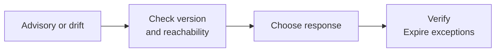

# Dependency lifecycle: keep a current decision for external code

This skill manages dependencies after adoption. Use it for advisories, abandoned upstreams, version drift, license changes, end-of-life dates, or packages that may no longer be used.

## Core concepts

- **Presence is not exposure.** An affected package may be installed without its vulnerable behavior being reachable. Unknown reachability remains unknown.
- **Findings need decisions.** Upgrade, pin, patch, isolate, replace, vendor, accept, or remove according to the actual exposure and constraints.
- **Exceptions need an end.** A pin, patch, or accepted risk needs an owner and a date or condition that reopens it.
- **Contracts determine upgrade scope.** A minor release can change a relied-on default or payload; a major release may leave your usage unaffected.

Ownership continues even when upstream maintains the code. Time can invalidate a dependency choice without any local commit, so review triggers must cover more than pull requests.

## Apply it

1. Identify the exact resolved version, usage, affected behavior, and evidence. Separate confirmed exposure from assumptions.
2. Choose a response and check API behavior, runtime requirements, persisted formats, licensing, and migration costs. Classify the change by its effect on this project.
3. Verify the response. Record remaining risk, its owner, and its expiry; remove temporary patches and unused packages when their conditions end.

## Project example

A parser advisory affects a dependency used by your upload endpoint. Trace whether uploaded data reaches the affected parser. If it does, prioritize a fix and check valid and hostile uploads after upgrading. If reachability cannot be established, keep that gap explicit rather than treating the scanner's silence as reassurance.

> `$dependency-lifecycle` Assess this advisory against our resolved package and upload path. Recommend a response with evidence and an expiry for any exception.

[Full skill](../.claude/skills/dependency-lifecycle/SKILL.md)

<!-- skill-revision: 7a393bfc4a99 -->
