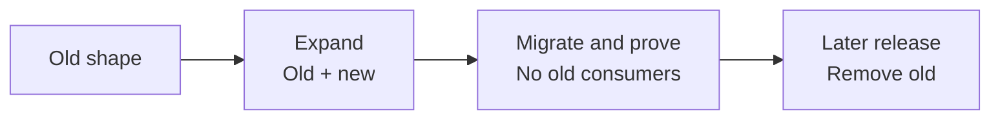

# Evolutionary data design: change shape without breaking live versions

This skill stages changes to databases, messages, API payloads, and file formats. Use it when adding, renaming, removing, narrowing, or reinterpreting data, changing keys or write ownership, or backfilling records.

## Core concepts

- **Versions coexist.** Current code, rollout code, and the rollback target may read and write the same data.
- **Inventory all consumers.** Reports, exports, scripts, and other services can depend on a shape without importing its code.
- **Expand before contracting.** Add compatible structure, migrate access and existing data, then remove the old structure in a later deployable.
- **Change meaning explicitly.** Cents becoming dollars needs a new element or version; keeping the name and type hides incompatible semantics.

Contracting requires evidence that old consumers have stopped using the shape, plus the required snapshot and data protections. A calendar date alone is not proof.

## Apply it

1. List readers, writers, coexisting versions, compatibility needs, and unknown consumers.
2. Plan additive schema changes, coordinated writes, an idempotent backfill, reader migration, and verification. Name the reversal path at every stage.
3. Contract only after the evidence gate passes. Keep the previous application compatible with the expanded schema during rollback; a destructive down migration can erase new data.

## Project example

Rename `customer.region` to `customer.market`. Add `market`, keep the two fields synchronized, backfill old records, and move readers. Confirm deployed consumers no longer use `region`. Remove it in a separate release after the rollback window and evidence requirements are satisfied.

> `$evolutionary-database-design` Plan the region-to-market rename across the application and reports. Include coexistence, backfill, rollback, and evidence required before removal.

[Full skill](../.claude/skills/evolutionary-database-design/SKILL.md)

<!-- skill-revision: 25e2999435dd -->
