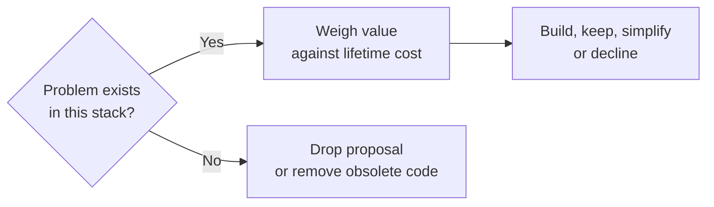

# Functionality versus complexity: does this earn its cost?

This skill decides whether to build proposed functionality or keep existing code. Use it for feature triage, dead-code reviews, speculative abstractions, defensive checks, or a feature whose upkeep exceeds its apparent value.

## Core concepts

- **Necessity comes first.** Verify the problem can occur in this stack. Identify a concrete trigger before prescribing a fix.
- **Value and cost stay separate.** Value depends on need, frequency, reach, and alternatives. Cost includes structure, maintenance, risk, and constraints on future change.
- **Reversibility changes the bar.** Public contracts and stored data need stronger evidence than easily removed internal choices.
- **Existing code gets the same scrutiny.** Past effort does not justify future maintenance.

Low usage does not cancel an actual accessibility, safety, or compliance obligation. Missing telemetry does not prove something is unused. Read the original rationale before removing an apparently unnecessary safeguard.

## Apply it

1. Identify who needs the behavior, when they need it, and what happens without it. Check the actual framework and deployment guarantees.
2. Compare the smallest useful solution with its lifetime costs. Keep measured performance or safety constraints visible.
3. Decide whether to build, defer, drop, keep, simplify, or remove. If evidence is missing, name the measurement needed before an irreversible choice.

## Project example

A plugin registry supports one statically loaded email template. No second plugin is planned. Trace callers and check whether the registry provides any real policy or compatibility guarantee. Direct registration may preserve the behavior while removing unused generality. Low observed traffic alone would not establish that conclusion.

> `$functionality-complexity-tradeoff` Check whether `core/plugin-registry` is still justified. Verify its actual callers and original rationale before recommending removal.

[Full skill](../.claude/skills/functionality-complexity-tradeoff/SKILL.md) · [Detailed diagram](functionality_pruner.svg)

<!-- skill-revision: 8c043c46ffde -->
