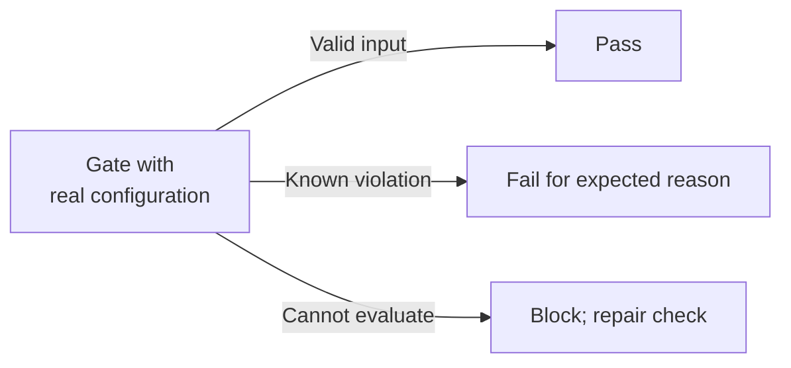

# Gate lifecycle: prove checks still check

This skill maintains lint rules, CI checks, hooks, budgets, and debt baselines. Use it when a gate misses a violation, its scope changes, exceptions grow, or someone proposes suspending or retiring it.

## Core concepts

- **A pass needs a proven failure path.** Feed known-bad input through the real configuration and check that it fails for the expected reason.
- **Effective scope matters.** Globs, ignore lists, configuration overrides, and result aggregation can silently reduce coverage.
- **Baselines are debt.** Existing violations may be recorded, but new entries require an explicit decision. A failed run must not rewrite the baseline to accept itself.
- **Unable to evaluate is a separate state.** Tool crashes or missing credentials establish neither compliance nor a violation. Repair evaluation while keeping the gate blocking.

Trials and suspensions need a measurable criterion, owner, and enforced expiry. An undecided expired trial restores the gate. Retirement requires evidence that its obligation disappeared or a proven replacement covers it.

## Apply it

1. Name the obligation, configured scope, actual coverage, and negative control.
2. Exercise both the check and any scripts that aggregate results or regenerate baselines. Confirm skips and errors cannot become silent passes.
3. Record intentional changes to scope or exceptions. Make expiry executable rather than leaving a reminder in a comment.

## Project example

A new ESLint block accidentally overrides the rule protecting auth internals. A normal lint run stays green. A negative-control fixture imports those internals and must fail through the complete project configuration; it exposes the override even though the rule's isolated unit test passes.

> `$gate-lifecycle` Check why our auth boundary gate passed a forbidden import. Prove its effective configuration rejects that import again.

[Full skill](../.claude/skills/gate-lifecycle/SKILL.md)

<!-- skill-revision: 1a3e287ad15b -->
