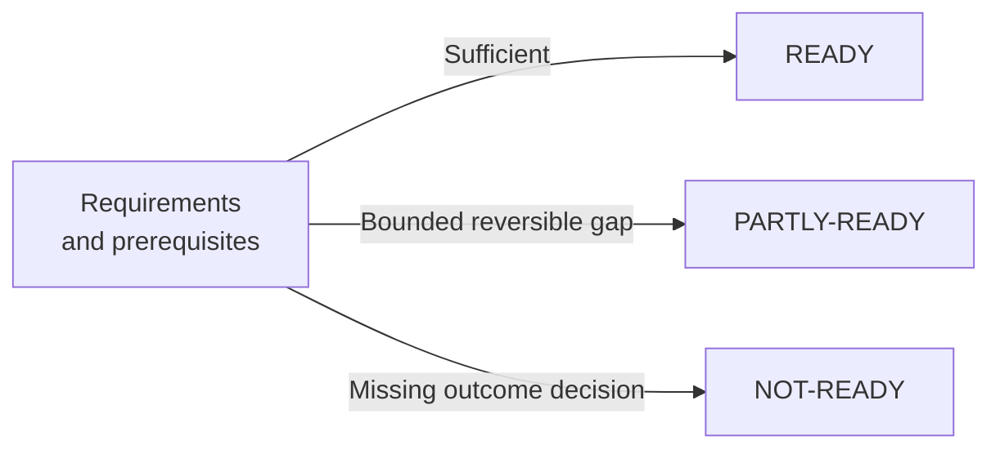

# Implementation readiness: can this work start responsibly?

This skill turns structured requirements into a buildable preparation package. Use it before architecture or development when you need a readiness decision, an implementation order, or the smallest coherent increment.

## Core concepts

- **READY:** requirements, observable completion conditions, ownership, and prerequisites are sufficient to proceed.
- **PARTLY-READY:** a bounded increment can proceed under an explicit reversible assumption.
- **NOT-READY:** a missing decision or dependency prevents responsible work.

Product and policy questions that change the required outcome block the affected work. Engineering choices can remain open for architecture to resolve. Prerequisites must exist, have a usable minimal contract, or be named as blockers.

Preparation derives capability groupings, dependency order, contract candidates, and domain terms from the requirements. It does not invent payloads or turn requirement dependencies into service boundaries. Ready, implemented, and verified are separate facts.

## Apply it

1. Provide the canonical requirements and dependency relationships. Check actors, completion criteria, data ownership, and relevant security, privacy, accessibility, and operational obligations.
2. Give each blocking question an owner. Separate decisions about the required outcome from choices about implementation.
3. Select one thin end-to-end increment, preferably testing the riskiest assumption first. Identify work that is genuinely independent before scheduling it in parallel.

## Project example

An approval flow has agreed roles and completion criteria, but the notification provider is undecided. The approval increment may proceed if it has a usable delivery contract and a reversible assumption. If nobody has decided who may approve, that part is not ready: choosing a queue cannot resolve the policy gap.

> `$implementation-readiness` Check whether report approval can start. Identify policy blockers, contract candidates, and the smallest end-to-end increment.

[Full skill](../.claude/skills/implementation-readiness/SKILL.md)

<!-- skill-revision: d11c34e13f07 -->
