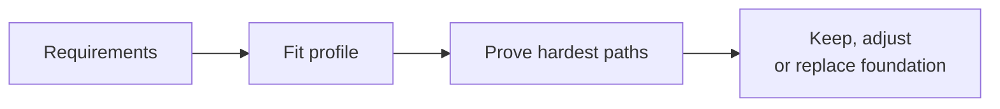

# Infrastructure fit: choose foundations from requirements

This skill chooses or rechecks a datastore, identity provider, hosting model, region, or tenancy model. Use it when inheriting a template, before real data arrives, or when requirements and platform workarounds change.

## Core concepts

- **Profile before platform.** Start with entities, relationships, hard queries, scale, isolation, data lifecycle, workload, operating capacity, cost, and exit constraints.
- **Defaults are provisional.** A working starter template proves integration, not suitability for your product.
- **Reversal cost sets scrutiny.** A formatter is easy to replace; a populated datastore or identity system may require a migration.
- **Tripwires make reviews happen.** A signal needs a threshold, owner, and evaluation point.

Fit reviews consider future costs. Money already spent does not make an unsuitable foundation cheaper to keep. Missing requirements stay visible rather than becoming confident platform choices.

## Apply it

1. Build a short fit profile from the real requirements. Name unknowns that could change the choice.
2. Compare the current foundation with plausible alternatives against the hardest constraints. Prove difficult paths with a walking skeleton: authorization, tenant isolation, backup restoration, erasure, deployment, rollback, and critical queries as applicable.
3. Decide what to keep, adjust, watch, migrate, or defer. Give provisional choices measurable review triggers; rehearse data movement before a production migration.

## Project example

A template supplies a document database, but the product needs cross-entity reports and transactional uniqueness. Count the application-side joins and integrity workarounds, then test the hardest report and transaction against candidate stores. Decide from those results and the operating constraints rather than the template's popularity.

> `$infrastructure-fit` Recheck our inherited datastore against reporting, transactions, tenant isolation, and operating cost. Name the evidence that would justify migration.

[Full skill](../.claude/skills/infrastructure-fit/SKILL.md)

<!-- skill-revision: 8db8bb5d4c13 -->
