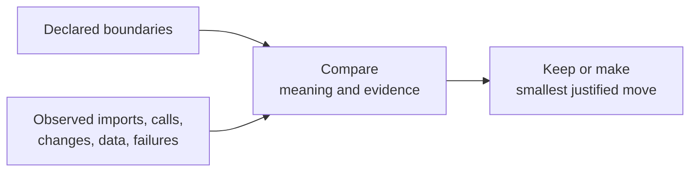

# Morphogenetic architecture: let evidence shape boundaries

This skill places subsystems and revisits boundaries when the system's behavior disagrees with its declared design. Use it for new subsystem placement, cycles, tangled responsibilities, or proposed moves, splits, and merges.

## Core concepts

Every subsystem has three coordinates: **domain** (business ownership), **tier** (orchestrator, capability, or primitive), and **layer** (consumer, application/domain, or infrastructure). It exposes an inbound interface and declares outbound dependencies.

Keep five kinds of evidence distinct:

- **Static:** imports.
- **Runtime:** calls and events.
- **Change:** files changing together.
- **Data:** shared shapes and stores.
- **Failure:** faults spreading across boundaries.

Static dependencies must be acyclic. Legitimate runtime loops need bounds, ownership, and monitoring. Indirection can hide an edge from import analysis without removing the coupling.

## Apply it

1. Start with a Rapid check of the declared position and nearby edges. Escalate to Full for restructuring, broader evidence, or ambiguity.
2. Support a boundary change with domain meaning and independent observed evidence. Compare a genuinely different candidate and measure complexity before accepting the move.
3. Choose the smallest justified change. State enforcement, reversal, and a measurable prediction with a review window.

When deciding evidence cannot yet exist, a reversible probationary change needs instrumentation, expiry, and a way back. Contradictory measured evidence does not qualify as missing evidence.

## Project example

Checkout coordinates payments and shipment. Separate responsibilities suggest a split; change history tests whether those responsibilities evolve independently. Compare splitting the coordinators with retaining one coordinator behind clearer contracts. Check actual dependency and complexity effects before choosing.

> `$morphogenetic-architecture` Check whether checkout's payment and shipment coordination should split. Compare alternatives using domain ownership and change evidence.

[Full skill](../.claude/skills/morphogenetic-architecture/SKILL.md) · [Detailed diagram](morphogenetic_architecture.svg)

<!-- skill-revision: 05599595d322 -->
