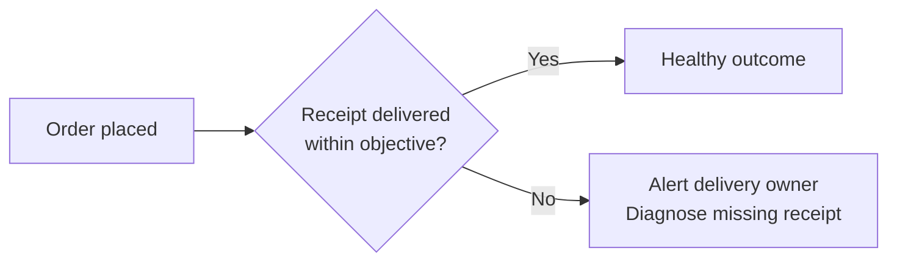

# Observability design: detect failures users actually experience

This skill decides what production signals a change needs and keeps existing signals useful. Use it when a risk survives testing, a failure went unnoticed, or alerts and dashboards create cost without helping anyone act.

## Core concepts

Signals have three jobs:

- **Detect:** show that something is wrong through rates, ratios, latency, or probes.
- **Diagnose:** identify where and why through logs, traces, and contextual events.
- **Verify:** establish whether a rollout restored or preserved the required behavior.

Measure at the boundary where value is delivered. A running worker does not prove receipts arrive. No alert does not prove health, and an uninstrumented failure has an unknown rate.

An alert needs a requirement or objective behind its threshold, a recipient, and a useful first action. A signal that informs investigation without requiring immediate action may belong on a dashboard instead.

## Apply it

1. List the material production failure modes left after verification. For each, identify the observable user consequence.
2. Choose the smallest signal set that can detect, diagnose, and verify recovery. Define thresholds, ownership, response, retention, and review timing.
3. Exercise the failure path and notification route. Periodically remove duplicate alerts, unused dashboards, and telemetry without a consumer.

## Project example

The email worker consumes messages but silently discards receipts. Queue depth and process uptime stay healthy. Compare receipt-delivery outcomes with orders requiring receipts, within an agreed delivery window. Add correlation details for diagnosis and a probe that confirms the delivery path. Alert the delivery owner when the objective is breached.

> `$observability-design` Design detection for silently lost order receipts. Include the user-facing signal, threshold basis, diagnostic context, owner, and first response.

[Full skill](../.claude/skills/observability-design/SKILL.md)

<!-- skill-revision: 5b4d49c026b5 -->
