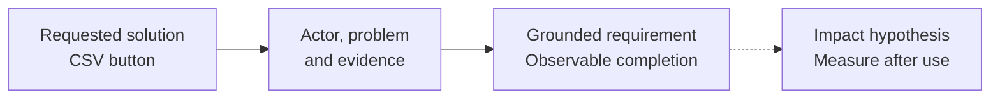

# Requirements grounding: establish the problem before the solution

This skill connects proposed requirements to real actors, sources, and evidence. Use it when a ticket prescribes a solution, an obligation is unclear, or you need to recover provisional intent from an existing system.

## Core concepts

- **Problem:** who faces what obstacle, in which situation, and what outcome they need.
- **Scope:** the observable state that resolves the problem and what is excluded.
- **Basis:** authoritative obligation, interpretation, observed evidence, or hypothesis. Attach the source and confidence.
- **Completion:** observable conditions showing the capability works.
- **Impact:** a separate hypothesis about what real use will improve, with baseline, target, owner, and measurement window.

Priority does not establish certainty. A must-have can still rest on an untested assumption. Review relevant quality obligations, including security, accessibility, and recovery; unsupported needs remain open questions rather than invented requirements.

## Apply it

1. Provide stakeholder statements, authoritative sources, observed problems, and current workarounds. Replace solution-first wording with an actor-bound problem.
2. Separate confirmed facts, interpretations, and assumptions. Validate uncertain claims in proportion to the cost and difficulty of reversing a wrong choice.
3. Record grounded requirements, completion conditions, scope, and owned questions. When recovering from code, keep candidates provisional until the domain owner confirms them.

## Project example

“Add a CSV button” becomes: “At month-end, finance needs report figures in its accounting system without manual re-entry.” Check the required interchange format before choosing the solution. A compatible export proves capability; whether close time falls from four hours to two needs later measurement.

> `$requirements-grounding` Ground this CSV-export request in finance's actual workflow. Separate completion criteria from the expected reduction in close time.

[Full skill](../.claude/skills/requirements-grounding/SKILL.md) · [Outcome evidence](READ-requirements-traceability.md#the-outcome-evidence-loop)

<!-- skill-revision: eee953e57a25 -->
