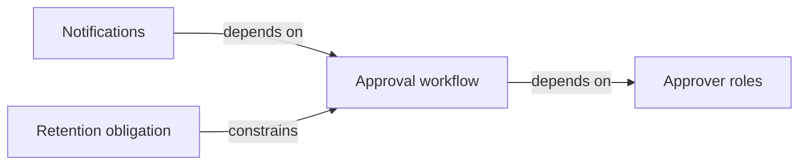

# Requirements topology: make dependencies explicit

This skill structures grounded requirements into an atomic, traceable dependency graph. Use it when planning repeatedly discovers hidden blockers, requirements overlap, or changes leave contradictory and stale references.

## Core concepts

- **Atomic nodes:** one outcome or obligation per requirement, with a stable readable ID.
- **Typed edges:** distinguish “depends on,” “enables,” “constrains,” “verifies,” and data-producing relationships. Record evidence and direction.
- **Visible decisions:** duplicates and conflicts need resolution; a generic “related to” link hides the actual relationship.
- **Derived views:** build order, diagrams, and registers come from the canonical model rather than independent manual copies.

Only prerequisite edges determine dependency order. Priority does not make an unavailable prerequisite exist. A requirement dependency also does not prescribe an API call, service boundary, or deployment unit.

## Apply it

1. Start with grounded requirements. Split compound statements without changing their meaning; preserve IDs and lineage when requirements split or merge.
2. Add evidenced relationships. Check cycles, missing references, conflicts, duplicates, unverified requirements, and apparently disconnected nodes.
3. Derive the dependency order. When replacing an obligation, retire its predecessor in the same change, or mark it lapsing with an explicit end condition.

A cycle in prerequisite relationships is a modeling problem to resolve before scheduling the work. An independent node is acceptable when that independence has been checked.

## Project example

Approval notifications require an approval workflow, which requires agreed approver roles. Record those prerequisite relationships before scheduling notification work. A separate retention requirement constrains stored approval records; it is not another workflow step. The graph reveals which decisions must be settled first without deciding the system architecture.

> `$requirements-topology` Structure our approval requirements. Expose prerequisites, retention constraints, conflicts, and missing verification; derive a valid delivery order.

[Full skill](../.claude/skills/requirements-topology/SKILL.md)

<!-- skill-revision: ab5f49caea45 -->
