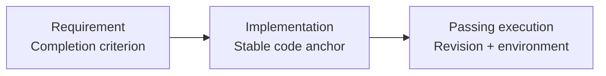

# Requirements traceability: connect promises to proof

This skill links requirements to implementation, decisions, verification, and outcome evidence. Use it when you need to show what authorized a change, where a criterion is implemented, and what proves it works.

## Core concepts

- **Forward trace:** requirement → implementation → executed evidence.
- **Reverse trace:** change → requirement or an explicit maintenance rationale.
- **Implementation is not verification.** A code anchor or test definition locates work. Verification needs a passing execution tied to a revision and environment.
- **Evidence expires.** Old runs and broken references cannot establish the current state.

Keep stable IDs near the artifacts they describe and generate overview matrices from them. Links record evidence; they do not change requirement meaning or authorize behavior the requirement never requested.

## Apply it

1. Map each completion criterion to stable implementation and verification anchors.
2. Attach reproducible run identities and results. Mark unmapped, implemented, verified, blocked, and explicitly inapplicable cases honestly.
3. Repair stale links with the change. Give gaps owners and distinguish deferred verification from a passing check.

## The outcome-evidence loop

Tests show whether the capability works. Real-use measurements show whether it helps. Link measurements to the original hypothesis, baseline, target, guardrails, cohort, and window. At its review trigger, use that evidence to reconsider the capability's worth; do not relax the target to match the result.

## Project example

The approval requirement links to the authorization handler and tests for permitted and forbidden approvers. A passing run proves those criteria at its revision. A later measurement of approval turnaround tests the separate impact hypothesis. Neither deployment nor a test file alone proves both claims.

> `$requirements-traceability` Map report-approval criteria to code and executed checks. Show gaps and track turnaround-time evidence separately.

[Full skill](../.claude/skills/requirements-traceability/SKILL.md)

<!-- skill-revision: d6fdf81fa46b -->
