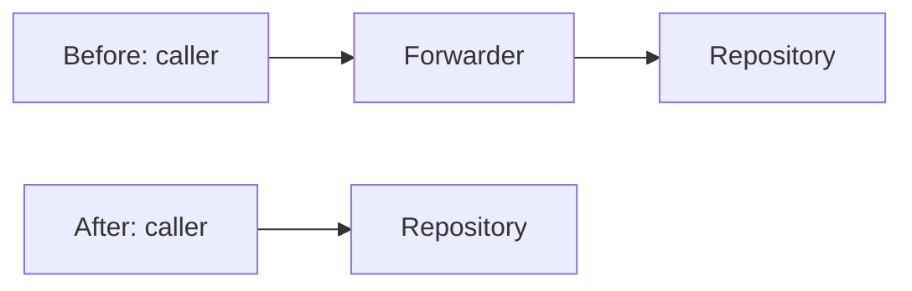

# Structural simplification: measure what gets simpler

This skill evaluates restructuring through four separate complexity measures. Use it before accepting a refactor, consolidation, abstraction, or workflow change described as “simpler.”

## Core concepts

| Axis | What to count | Cost it reveals |
| --- | --- | --- |
| Diversity (D) | Distinct kinds, patterns, or concepts | Learning |
| Coupling (K) | Relationships and their density | Coordinated change |
| Depth (P) | Longest dependency or forwarding chain | Tracing behavior |
| Quantity (n) | Subsystems or items in the chosen model | Navigation |

Measure the same scope before and after. Keep the four deltas separate: one combined score can hide a serious regression. A facade may hide complexity while adding another hop; merging folders may move coupling inside rather than remove it.

Cycles in a structure that must be acyclic block acceptance. So does erasing distinctions that callers actually rely on. Required security, behavior, compatibility, and performance still constrain the result.

## Apply it

1. Model the current and proposed structure with a consistent unit of counting. Record each before/after delta.
2. Check cycles, preserved distinctions, new concepts, new connections, and longer paths.
3. Accept improvements or justify a mixed trade explicitly. If no axis improves, do not call the result a simplification. Consider a smaller alternative.

## Project example

A service layer forwards every call to a repository without validation, policy, or isolation. Removing it shortens the chain and removes an item, but exposes callers directly to the repository. Check whether that coupling is acceptable before claiming a win. If the layer owns authorization, deleting it breaks a required guarantee.

> `$structural-simplification` Compare keeping versus removing this forwarding layer. Show all four deltas and identify any behavior or boundary it protects.

[Full skill](../.claude/skills/structural-simplification/SKILL.md) · [Detailed diagram](structural_simplification.svg)

<!-- skill-revision: fa5dd14549e2 -->
