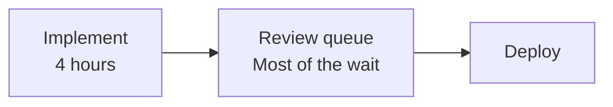

# System optimization: improve the flow of real work

This skill finds waste and bottlenecks across delivery, testing, tooling, code, and operations. Use it when changes take too long, queues grow, or proposed optimizations lack a measured benefit.

## Core concepts

- **Follow a change end to end.** Separate time spent working from time spent waiting.
- **Find the constraint.** Improving a non-bottleneck may only feed work into the bottleneck faster.
- **Limit work in progress.** In a stable process, average cycle time equals average work in progress divided by throughput.
- **Keep capacity headroom.** Saturated reviewers and runners build queues when arrivals and task durations vary.
- **Prefer small batches.** Smaller changes shorten feedback and reduce the size of failures.

Stability comes before tuning. Measure a baseline and distinguish normal variation from a real change. When used through Alchemy, optimization follows the shipped increment in a later iteration; on a system already running, it starts by measuring that baseline.

## Apply it

1. Trace representative recent changes from request to production. Measure waits, processing time, rework, and the largest queue.
2. Question unnecessary requirements and steps, delete what is unneeded, simplify what remains, then speed up and automate. Protect the constraint before buying capacity.
3. Make one measurable improvement and compare it with the baseline. Watch delivery speed alongside failure rate and recovery; faster shipping alone is insufficient.

## Project example

A change takes ten days to ship but only four hours to implement. Review consumes most of the wait. Faster compilation will barely affect the result. Try smaller PRs, fewer simultaneous changes, and protected reviewer time, then measure review wait and overall lead time again.

> `$system-optimization` Find our delivery bottleneck using recent PRs. Separate working time from waiting and propose the smallest measurable improvement.

[Full skill](../.claude/skills/system-optimization/SKILL.md) · [Detailed diagram](system_optimization.svg)

<!-- skill-revision: 7adaa2b6ba73 -->
