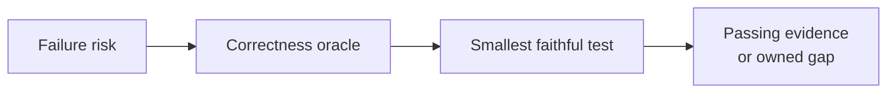

# Test strategy: choose evidence for the failures that matter

This skill selects the smallest sufficient set of tests for a project's requirements and risks. Use it when planning verification, reviewing a suite, choosing real dependencies versus doubles, or investigating an escaped defect.

## Core concepts

- **Start with failure modes.** Identify what can go wrong, its impact, and its likelihood. Unknown exposure remains a gap.
- **Define the oracle.** State how a test distinguishes correct from incorrect behavior before choosing its framework or level.
- **Use sufficient fidelity.** A pure calculation can use direct function tests. Database compatibility needs evidence against real database semantics.
- **Treat doubles as claims.** Stubs and mocks of external behavior need a contract or real-boundary backstop against drift.

Coverage shows what ran; it does not establish that meaningful assertions checked the result. Flaky or quarantined checks do not provide trustworthy passing evidence. Each expensive test should cover a distinct risk.

## Apply it

1. List requirements, completion criteria, and material failure modes. For each, define a credible correctness check and the required environment or collaborators.
2. Choose the narrowest test that can observe the failure. Use mocks when the interaction itself is required, rather than as a default for every dependency.
3. Make data, time, and state controllable. Record residual risks, missing oracles, and owned gaps. Use escaped defects to revisit the portfolio.

## Project example

Invoices can be wrong even when the service returns a non-null object. Check agreed monetary results at rounding boundaries with pure tests. Use separate database tests for persistence semantics and a provider contract check for tax-service compatibility. Browser tests add value only for risks involving the browser flow.

> `$test-strategy` Design verification for invoice rounding, persistence, and tax-provider compatibility. Name the oracle and minimum sufficient fidelity for each risk.

[Full skill](../.claude/skills/test-strategy/SKILL.md)

<!-- skill-revision: 2657b44da290 -->
