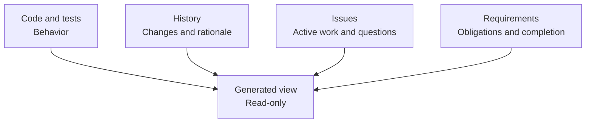

# Zero-copy requirements: give each fact one authoritative home

This skill decides where facts belong and removes documents that duplicate existing authority. Use it before adding documentation, when pruning a documentation tree, or when deciding where a decision or follow-up should live.

## Core concepts

If a document can be reconstructed entirely from those sources, generate it or remove it. A generated report is a view: mark it read-only and check drift. Links avoid maintaining the same fact twice.

Standalone onboarding guidance, required external deliverables, and frozen historical records can still earn a place. They must have a distinct purpose rather than become competing descriptions of live behavior.

## Apply it

1. For each claim, identify the artifact that already owns it. Prove redundancy before deleting; a unique claim needs an owner, not erasure.
2. Keep reversible technical decisions beside the implementing diff. Close owner questions where they were asked. Preserve approvals that need durable proof in a merged record.
3. Generate useful summaries from authoritative inputs. Keep open issues for active work, defects, or checks blocking a named milestone; keep unstarted obligations in the requirement register.

## Project example

A wiki repeats the nightly export schedule from CI configuration. Remove that duplicate schedule and link to the job. Keep the reason for choosing the time with the change that introduced it. Put a future requirement to support another timezone in the requirement register until work begins.

> `$zero-copy-requirements` Review our export documentation. Identify each fact's owner, remove proven duplication, and preserve unique rationale.

[Full skill](../.claude/skills/zero-copy-requirements/SKILL.md)

<!-- skill-revision: bd0a889723a3 -->
