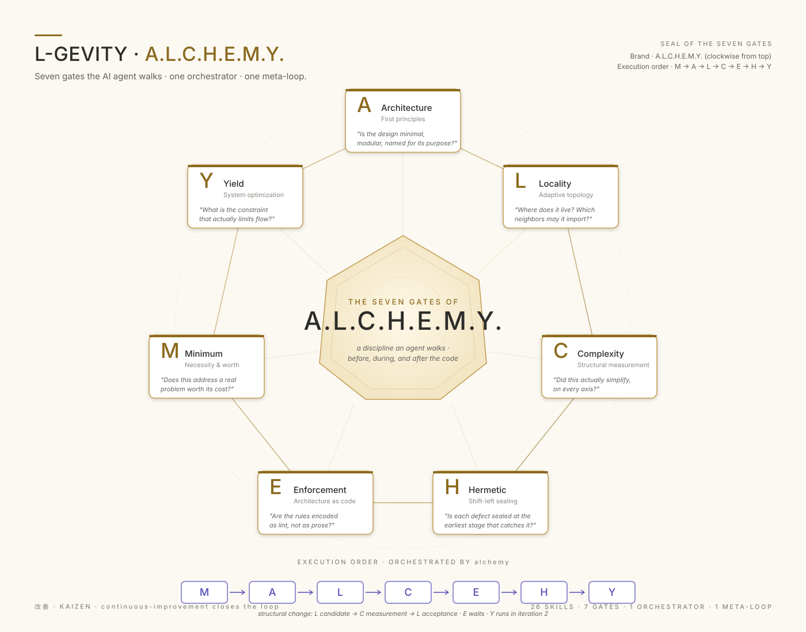
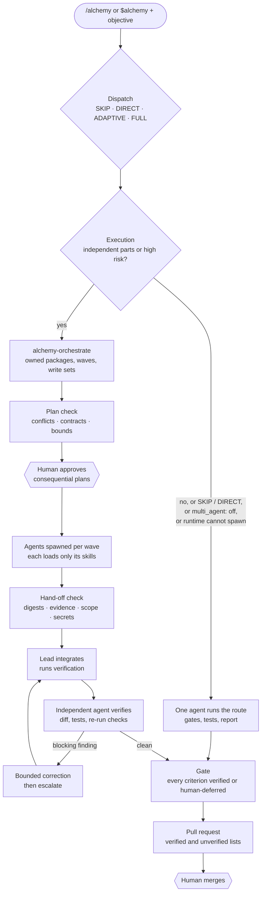
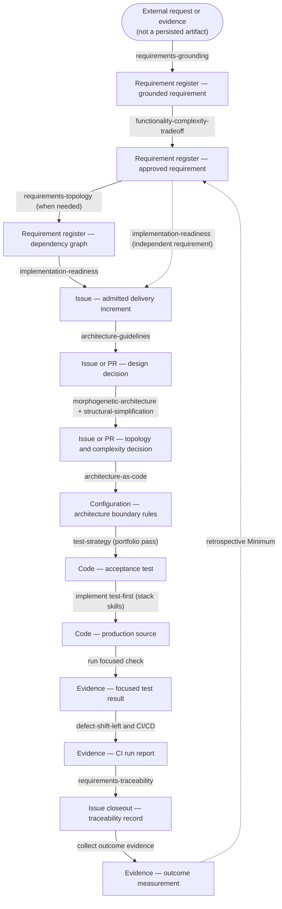

# ALCHEMY — your self-orchestrating software engineering team

The AI Architect by [Patrick Savalle](https://github.com/patricksavalle)

Give your coding agent an objective. ALCHEMY selects the engineering skills,
decides whether one agent or a team should do the work, and checks the result
against evidence before preparing a pull request for your approval.

Open-source and platform-agnostic. Start with `/alchemy` in Claude Code,
`$alchemy` in Codex, or “do some alchemy.”


[Get started](#get-started) · [Skills](#the-skill-library) ·
[Workflow](#the-right-amount-of-engineering) · [Agent teams](#one-agent-or-a-team) ·
[Configuration](#configure-a-workspace) · [Runtime support](#runtime-support-and-evidence) ·
[Under the hood](#under-the-hood)

## Get started

**Install.** Ask your coding agent:

> Install [l-gevity/l-gevity-skills](https://github.com/l-gevity/l-gevity-skills) into this project.

The same prompt updates an existing install.

**Use.**

```text
do some alchemy on this refactor

/alchemy this auth refactor       # Claude Code
$alchemy this auth refactor       # Codex
/alchemy M should we build this?  # one focused gate
/alchemy audit this PR            # structural audit
/alchemy ?                        # help
```

Other skills are invoked by name in the same way. There is nothing else to
set up: Claude Code, Codex, and Unstoppable also get agent teams, with
[defaults you can change](#configure-a-workspace).

<details>
<summary><strong>Installation details</strong></summary>

One [installer](./.install/) per agent, for Windows, Linux, and macOS. It
does three things:

1. Copies the skills into the agent's skills tree and records each file in
   `l-gevity-skills.lock.json`. A project that already keeps the other skills
   tree gets that tree updated as well.
2. Adds the root instruction file.
3. Sets up agent teams for Claude Code and Codex, and adds the Unstoppable
   pipeline when it runs in an Unstoppable session or the project has an
   `.unstoppable-code/` directory. This needs Python 3; without it the skills
   still install and the installer prints the command to run later. Gemini
   CLI and Grok CLI have no agent-team setup.

| Agent | Skills tree | Root instruction file |
|---|---|---|
| Claude Code | `.claude/skills/` | `CLAUDE.md` |
| Codex | `.agents/skills/` | `AGENTS.md` |
| Gemini CLI | `.agents/skills/` | `GEMINI.md` |
| Grok CLI | `.agents/skills/` | `GROK.md` |

An existing root instruction file or settings file is kept; the new version
is written beside it with a `.l-gevity` suffix for you to merge. Locally added
skills are not removed during updates. Set `L_GEVITY_SKILLS_REF` to pin a
branch, tag, or commit.

**Uninstall.** There is no uninstaller. Delete the files listed in
`l-gevity-skills.lock.json` and the lock itself, the root instruction file,
`alchemy-workspace.json`, `.alchemy/`, the `alchemy-*` agent files and
settings file under `.claude/` or `.codex/`, and the `alchemy-*` entries under
`.unstoppable-code/`. Keep any of these you have since edited for your own
use.

</details>

## The skill library

The library contains 24 composable skills. Each has a one-page guide with its
concepts, steps, and a project example. Start there; the operational
`SKILL.md` is what the agent loads. Links go to the Claude skills tree; Codex
uses the matching `.agents/skills/` tree.

| One-page guide | Skill |
|:--|:--|
| [Alchemy: choose the right amount of engineering](./.documentation/READ-alchemy.md) | [`alchemy`](./.claude/skills/alchemy/SKILL.md) |
| [Orchestration: use more agents only when it pays](./.documentation/READ-alchemy-orchestrate.md) | [`alchemy-orchestrate`](./.claude/skills/alchemy-orchestrate/SKILL.md) |
| [Requirements grounding: establish the problem before the solution](./.documentation/READ-requirements-grounding.md) | [`requirements-grounding`](./.claude/skills/requirements-grounding/SKILL.md) |
| [Functionality versus complexity: does this earn its cost?](./.documentation/READ-functionality-complexity-tradeoff.md) | [`functionality-complexity-tradeoff`](./.claude/skills/functionality-complexity-tradeoff/SKILL.md) |
| [Requirements topology: make dependencies explicit](./.documentation/READ-requirements-topology.md) | [`requirements-topology`](./.claude/skills/requirements-topology/SKILL.md) |
| [Implementation readiness: can this work start responsibly?](./.documentation/READ-implementation-readiness.md) | [`implementation-readiness`](./.claude/skills/implementation-readiness/SKILL.md) |
| [Architecture guidelines: design code that is cheap to change](./.documentation/READ-architecture-guidelines.md) | [`architecture-guidelines`](./.claude/skills/architecture-guidelines/SKILL.md) |
| [Morphogenetic architecture: let evidence shape boundaries](./.documentation/READ-morphogenetic-architecture.md) | [`morphogenetic-architecture`](./.claude/skills/morphogenetic-architecture/SKILL.md) |
| [Structural simplification: measure what gets simpler](./.documentation/READ-structural-simplification.md) | [`structural-simplification`](./.claude/skills/structural-simplification/SKILL.md) |
| [Architecture as code: make dependency rules executable](./.documentation/READ-architecture-as-code.md) | [`architecture-as-code`](./.claude/skills/architecture-as-code/SKILL.md) |
| [Evolutionary data design: change shape without breaking live versions](./.documentation/READ-evolutionary-database-design.md) | [`evolutionary-database-design`](./.claude/skills/evolutionary-database-design/SKILL.md) |
| [Test strategy: choose evidence for the failures that matter](./.documentation/READ-test-strategy.md) | [`test-strategy`](./.claude/skills/test-strategy/SKILL.md) |
| [Shift-left: catch defects at the earliest capable stage](./.documentation/READ-defect-shift-left.md) | [`defect-shift-left`](./.claude/skills/defect-shift-left/SKILL.md) |
| [Reliable CI/CD: deploy safely and recover predictably](./.documentation/READ-ci-cd-reliability-architecture.md) | [`ci-cd-reliability-architecture`](./.claude/skills/ci-cd-reliability-architecture/SKILL.md) |
| [Gate lifecycle: prove checks still check](./.documentation/READ-gate-lifecycle.md) | [`gate-lifecycle`](./.claude/skills/gate-lifecycle/SKILL.md) |
| [Requirements traceability: connect promises to proof](./.documentation/READ-requirements-traceability.md) | [`requirements-traceability`](./.claude/skills/requirements-traceability/SKILL.md) |
| [Observability design: detect failures users actually experience](./.documentation/READ-observability-design.md) | [`observability-design`](./.claude/skills/observability-design/SKILL.md) |
| [Infrastructure fit: choose foundations from requirements](./.documentation/READ-infrastructure-fit.md) | [`infrastructure-fit`](./.claude/skills/infrastructure-fit/SKILL.md) |
| [Dependency lifecycle: keep a current decision for external code](./.documentation/READ-dependency-lifecycle.md) | [`dependency-lifecycle`](./.claude/skills/dependency-lifecycle/SKILL.md) |
| [System optimization: improve the flow of real work](./.documentation/READ-system-optimization.md) | [`system-optimization`](./.claude/skills/system-optimization/SKILL.md) |
| [Push-out: move recurring work into durable systems](./.documentation/READ-push-out.md) | [`push-out`](./.claude/skills/push-out/SKILL.md) |
| [Bring-down: maintain less commodity code](./.documentation/READ-bring-down.md) | [`bring-down`](./.claude/skills/bring-down/SKILL.md) |
| [Zero-copy requirements: give each fact one authoritative home](./.documentation/READ-zero-copy-requirements.md) | [`zero-copy-requirements`](./.claude/skills/zero-copy-requirements/SKILL.md) |
| [Continuous improvement: fix the cause of repeat mistakes](./.documentation/READ-continuous-improvement.md) | [`continuous-improvement`](./.claude/skills/continuous-improvement/SKILL.md) |

ALCHEMY covers structural reasoning. Add your own skills for domain knowledge,
coding conventions, framework recipes, security, accessibility, and release
policy; matching companions run alongside the core gates.

## The right amount of engineering

`alchemy` routes each change to the questions it needs and skips the rest.
The guide explains how:
[Alchemy: choose the right amount of engineering](./.documentation/READ-alchemy.md).

| Dispatch | When it applies |
|:--|:--|
| `SKIP` | Routine local work; no structural analysis. |
| `DIRECT` | One focused question or gate. |
| `ADAPTIVE` | Structural work; the smallest ordered set of relevant gates. |
| `FULL` | Explicit `full` or `all` request; every justified stage, with skips recorded. |

A run reports its route, its verdict, and one next action:

```text
Dispatch:   ADAPTIVE
Core route: M, A, L, C, E, H
Companions: test-strategy
Execution:  multi-agent — orders and shipping are independent; payments is high-risk
Verdict:    Proceed | Redesign | Drop | Defer
Next:       one concrete action
```

Decision records open with four plain-language blocks: **What I found**,
**Why it matters**, **Do this first**, and **What I did not check**.

### The seven gates

Structural work answers up to seven questions, value first:
**M → A → L → C → E → H → Y**.

| Gate | Question | Guide |
|---|---|---|
| **M — Minimum** | Is the functionality worth its complexity? | [Functionality versus complexity](./.documentation/READ-functionality-complexity-tradeoff.md) |
| **A — Architecture** | Is the design minimal, modular, and purposeful? | [Architecture guidelines](./.documentation/READ-architecture-guidelines.md) |
| **L — Locality** | Is each subsystem in the right boundary? | [Morphogenetic architecture](./.documentation/READ-morphogenetic-architecture.md) |
| **C — Complexity** | Does the change measurably simplify the system? | [Structural simplification](./.documentation/READ-structural-simplification.md) |
| **E — Enforcement** | Can architectural rules be encoded as checks? | [Architecture as code](./.documentation/READ-architecture-as-code.md) |
| **H — Hermetic** | Is each defect caught at the earliest capable stage? | [Shift-left](./.documentation/READ-defect-shift-left.md) |
| **Y — Yield** | What constraint actually limits flow? | [System optimization](./.documentation/READ-system-optimization.md) |



Requirements skills qualify work before the gates when needed. Yield runs in
the iteration after an increment ships. Three DevOps improvement moves are
available on request:

| Command | Move | Guide |
|---|---|---|
| `/alchemy left` | Detect defects earlier. | [Shift-left](./.documentation/READ-defect-shift-left.md) |
| `/alchemy out` | Move recurring toil into durable systems. | [Push-out](./.documentation/READ-push-out.md) |
| `/alchemy down` | Replace bespoke code with reusable capability. | [Bring-down](./.documentation/READ-bring-down.md) |

## One agent or a team

One agent is the default. `alchemy-orchestrate` adds agents only when
independent work or a separate review justifies the coordination cost. Each
package then owns its files, shared contracts are decided before their
consumers start, hand-offs are checked against evidence, and an agent that
wrote none of the work reviews the integrated result. The guide has an example:
[Orchestration: use more agents only when it pays](./.documentation/READ-alchemy-orchestrate.md).

You keep the consequential decisions:

| Moment | Human role |
|:--|:--|
| Consequential plan (crosses a subsystem boundary, writes a protected path, exceeds the agent budget) | approve or stop |
| Accepted risk, deferred acceptance criterion, unresolved dispute | decide |
| Push and pull-request creation | approve, per the profile |
| Merge, deploy, destructive or external actions | always yours |

<details>
<summary><strong>A run from objective to pull request</strong></summary>



Corrections are bounded; unresolved findings escalate. The final gate requires
every acceptance criterion to be verified or explicitly deferred by you. The
[Multi-Agent Methodology Specification](./ALCHEMY-MULTI-AGENT.md) holds the
rules.

</details>

## Configure a workspace

Agent teams work with the defaults below. To change one, edit
`alchemy-workspace.json`. Commit it with the rendered agent files so
developers and runtimes share one configuration.

| Key | Default | Use |
|:--|:--|:--|
| `execution.multi_agent` | `auto` | `off` keeps every run single-agent |
| `execution.max_parallel_agents` | `3` | concurrent agents, lead excluded |
| `execution.max_rework_cycles` | `2` | correction rounds per origin chain before escalation; only a human-authorized `execution.rework_extension` in the approved plan raises it for a run |
| `repository.protected_paths` | `[]` | writes need human approval |
| `repository.verification` | `[]` | commands the integrated result must pass |
| `preflight.needs` | `[]` | prerequisites every unattended run of the project has; each preflight must cover them |

<details>
<summary><strong>Adding a runtime and changing limits</strong></summary>

The installers run the setup step for you. Run it yourself to add a runtime
the installer did not pick:

```sh
python .agents/skills/alchemy-orchestrate/scripts/init_workspace.py --runtime unstoppable
```

`claude-code`, `codex`, and `all` are the other choices. The step writes
`alchemy-workspace.json`, the runtime's agent definitions and settings, and
`.alchemy/runs/.gitignore`, which keeps run records out of commits.

`execution.multi_agent` and `execution.max_parallel_agents` are also written
into the runtime's settings file. After changing either, run the step again:
it keeps your settings file and writes the new one beside it with a
`.l-gevity` suffix for you to merge.

</details>

<details>
<summary><strong>Plan keys and unattended runs</strong></summary>

A plan sets its own keys (`execution.unattended`, package `needs`,
`execution.rework_extension`, `amendments`);
[contracts.md](./.agents/skills/alchemy-orchestrate/references/contracts.md)
defines them.

At the Unstoppable plan approval, `continue-attended` means you watch until the
pull request approval; `continue-unattended` stops the run unless the plan sets
`execution.unattended`. An unattended plan gives every package its `needs`; the
lead proves each in `preflight.json`, the first wave starts only when
`check_orchestration.py preflight` returns `PASS`, and the gate takes
`--preflight <preflight.json>`. See
[autonomy-preflight.md](./.agents/skills/alchemy-orchestrate/references/autonomy-preflight.md).

</details>

<details>
<summary><strong>Inspect and recheck a run</strong></summary>

Run records live in `.alchemy/runs/<run-id>/`: `plan.json` (packages, owners,
write sets, waves), `handoffs/<package>.json`, and `ledger.json` (criteria,
evidence, findings, disputes). Re-check any of them yourself:

```sh
C=.agents/skills/alchemy-orchestrate/scripts/check_orchestration.py
R=.alchemy/runs/<id>
D=<approved_digest>  # printed by the plan check for the plan the human approved
python $C plan    $R/plan.json                          --profile alchemy-workspace.json --approved $D
python $C handoff $R/handoffs/P1.json --plan $R/plan.json --profile alchemy-workspace.json --root .
python $C gate    $R/ledger.json      --plan $R/plan.json --profile alchemy-workspace.json --root . --approved $D
```

Without `--approved`, a plan with amendments, and a gate whose plan carries an
extension or whose ledger records rework, fail `AMENDMENT_INVALID`; a setup
that passed before rework was anchored adds it, as the
[upgrade table](./.agents/skills/alchemy-orchestrate/references/contracts.md#ledger--alchemy-ledger1) states.

Your runtime's transcript shows which agents were spawned and which skills
each loaded.

</details>

## Runtime support and evidence

The method names no runtime; adapters launch and isolate agents in Claude
Code, Codex, or Unstoppable. Single-agent execution is the baseline. Pilot
runs demonstrate delegation, skill loading, parallel work, dependency order,
bounded recovery, and gate checks, with different coverage per runtime. They
do **not** establish that multi-agent execution is generally better: on one
audit fixture it fixed 10 of 10 seeded defects versus 9 of 10 at roughly two
to four times the cost.

<details>
<summary><strong>Runtime support and unverified paths</strong></summary>

Every row below is backed by a recorded run in [.pilot/results](./.pilot/results/);
the acceptance facts in each result are extracted from the runtime's own event
stream or saved sessions, not from the agent's summary.

| Runtime | How agents are launched | Verified by real runs | Not verified |
|:--|:--|:--|:--|
| Claude Code | Native: the lead's Agent tool with `alchemy-implementer` (own git worktree) and `alchemy-analyst` (read-only) | A trivial `/alchemy` task stayed single-agent with no launch. Complex `/alchemy` objectives chose multi-agent unprompted and launched real agents. Two implementers ran in parallel in separate worktrees, the verifier started only after both finished, its two major findings were corrected in two bounded rework cycles, and the gate passed. Delegated agents loaded their own ALCHEMY skills. An injected agent crash was retried once. Independent reviewers drove corrections, and the gate held at `FAIL` for a decision only the human can make. | Cost and time of the completed parallel rerun, whose runner process died; its outcome is reconstructed from the run's own artifacts. |
| Codex | Native: `spawn_agent` / `wait_agent`, with the custom agents in `.codex/agents/` | `codex exec` lists and spawns `alchemy-analyst`, which answers in the hand-off format. A `$alchemy` audit chose multi-agent unprompted. A depth-1 reviewer sub-agent, recovered from Codex's saved sessions, loaded its skills, found a money defect by executing a reproduction, and was re-run after the lead's correction. | Parallel implementers, and an injected failure. The reviewer ran as Codex's default agent type, not as `alchemy-analyst`. |
| Unstoppable | Preconfigured workflow: the `alchemy-multi-agent` pipeline (plan, plan check, human approval with an attended or unattended choice, preflight for an unattended run, native sub-agents, cross-provider review, gate, human approval, pull request). In a chat, the Claude Code or Codex mechanism above. | The pipeline validates and runs from the CLI. In four runs, planning produced multi-wave plans that passed the plan check, the human checkpoint paused each run, and execution launched sub-agents into isolated worktrees. When execution could not finish, the lead escalated rather than claiming success: once for a repository defect, and twice when its turn ended with agents still running ([record](./.pilot/results/unstoppable-pipeline-runs.json)). | A complete pass through review, gate, and pull request. The run with foreground waves was stopped before execution finished. The preflight jobs have not run in the runtime. |
| Other agents (Gemini CLI, Grok CLI) | None shipped | — | Fallback: single-agent, with the limitation reported |

The adapter details, every mechanism, and every limitation are in the
[adapters reference](./.agents/skills/alchemy-orchestrate/adapters/README.md).

</details>

<details>
<summary><strong>Pilot results, costs, and timings</strong></summary>

The pilot in [.pilot/](./.pilot/README.md) runs the normal `/alchemy` or
`$alchemy` entrypoint on a small backend with ten seeded defects (correctness,
security, dead code, layering, duplication), and scores the result with hidden
tests. Only the profile differs between arms: `execution.multi_agent` is `off`
for the baseline.

| Run | Execution | Agents launched | Seeded defects fixed | Visible tests | Cost | Time |
|:--|:--|:--|:--|:--|:--|:--|
| Claude Code, trivial rename | single-agent (`SKIP`) | 0 | n/a | pass | $0.34 | 24 s |
| Claude Code, audit, baseline (`off`) | single-agent | 0 | 9 / 10 | pass | $5.42 | 13 min |
| Claude Code, audit | lead + 1 independent analyst | 1 | 10 / 10 | pass | $10.46 | 23 min |
| Claude Code, audit, injected agent crash | lead + 2 parallel reviewers, crash retried | 3 (1 blocked) | 10 / 10 | pass | $21.22 | 42 min |
| Claude Code, two independent features | 2 parallel implementers, then 1 verifier; the verifier was stopped by the headless background limit, so no `PR.md` | 3 | n/a (feature task) | pass | $10.46 | 23 min |
| Same, rerun with the bounded wait | 2 parallel implementers, then 1 verifier; 2 major findings, 2 correction cycles, gate `PASS` | 3 or more | n/a (feature task) | pass, 31 / 31 | not captured¹ | not captured¹ |
| Codex, audit (harness ran `--ephemeral`) | multi-agent chosen; spawns failed | 0 | 8 / 10 | pass | not reported | 6.5 min |
| Codex, audit | lead + 1 reviewer sub-agent | 1 | 8 / 10 | pass | not reported | 5 min |

What these runs do and do not show:

- **Shown:** the decision, the delegation, skill loading, parallelism,
  dependency order, bounded recovery, and the gate behave as specified.
- **Not shown:** that multi-agent finds more defects in general. With one
  fixture and one run per arm, multi-agent fixed one more seeded defect than
  the baseline (10 vs 9) at roughly two to four times the cost.
- **How to treat them:** as a reproducible smoke test of the behavior, not a
  benchmark. Keep multi-agent where your own baseline shows it pays.

¹ The runner process died mid-run while the Claude Code session finished; the
row is reconstructed from the run's own git history, run records, and
`PR.md` in
[claude-multi-parallel-2.evidence.json](./.pilot/results/claude-multi-parallel-2.evidence.json),
so cost and time were not captured.

</details>

### Limits to account for

- **Cost.** A multi-agent run pays one context load per agent plus planning,
  checking, and integration; keep it only where it beats the single-agent
  baseline on your own work (the specification's quality model, §11).
- **Enforcement varies by runtime.** Claude Code enforces read-only agents,
  delegation depth 1, and the concurrency cap through its settings; Codex
  enforces only the cap, and relies on instructions plus the hand-off check
  for the rest; Codex agents share one working directory.
- **Non-interactive runs must wait for their agents.** In headless and
  pipeline runs, a lead whose turn ends while sub-agents still run loses them;
  the adapters bound the background wait and launch waves in the foreground.
  Interactive sessions are not affected.
- **Permission rules are guardrails.** A deny rule matches command text, so it
  is not a sandbox; the hand-off and gate checks are the backstop.
- **Not exercised end to end:** cross-repository work, and the real
  production backend the issues name (it is not in this repository; the pilot
  uses a representative fixture).
- **Gemini CLI and Grok CLI** install the skills but get no adapter; they run
  single-agent.

## Under the hood

The specifications are the [pipeline design](./ALCHEMY-PIPELINE-DESIGN.md)
(routing rules, requirements qualification, gate handshakes) and the
[Multi-Agent Methodology Specification](./ALCHEMY-MULTI-AGENT.md). The blocks
below summarize the parts most often asked about.

<details>
<summary><strong>Vocabulary and quality dimensions</strong></summary>

Four terms recur: **subsystem** (where change lands), **aspect** (one
obligation and mechanism across subsystems), **increment** (what changes), and
**iteration** (a cycle that admits, implements, and measures an increment).
`alchemy` defines them; each skill's local vocabulary specializes one.

A change is judged separately on three dimensions, never collapsed into one
score:

| Dimension | Measures | Guide |
|:--|:--|:--|
| Topology | Domain, tier, and layer: legality first, then pressure. | [Morphogenetic architecture](./.documentation/READ-morphogenetic-architecture.md) |
| Structure | Kinds, edges, depth, and number of subsystems. | [Structural simplification](./.documentation/READ-structural-simplification.md) |
| Flow | Left, out, and down. | [System optimization](./.documentation/READ-system-optimization.md) |

</details>

<details>
<summary><strong>From requirements to measured outcomes</strong></summary>



Grounding keeps decision-relevant outcome hypotheses separate from acceptance
criteria, avoiding confusing impact with completion. Traceability maintains
versioned outcome measurements and freshness. Revisiting value after release
returns current evidence to Minimum for a new worth decision. See the
[outcome-evidence loop](./.documentation/READ-requirements-traceability.md#the-outcome-evidence-loop).

</details>

<details>
<summary><strong>Placement, restructuring, and probation</strong></summary>

Architecture is a hypothesis checked against the code and the running system.
The guide and its
[detailed diagram](./.documentation/morphogenetic_architecture.svg) explain
the model: [Morphogenetic architecture](./.documentation/READ-morphogenetic-architecture.md).

Locality starts with a **Rapid placement/static-edge scan** of position
legality. It escalates **Rapid → Full** for
**restructure · non-static evidence · broad scope · ambiguity**.
Rapid can return `PLACE`, `KEEP`, `DECLARE-RUNTIME-CYCLE`, or `DEFER`; Full can
also return `MOVE`, `SPLIT`, `MERGE`, or `INTRODUCE-BOUNDARY`.

Topology changes follow **L candidate → C measurement → L acceptance**.
L re-enters once; **Gate E cannot run before** that acceptance.

If only an unobtainable measurement is missing, a sufficiently reversible
change (High or Medium reversibility) may proceed **on probation**. It must
record an expiry, an instrumentation task, and a reversal path, with a recheck
at Gate H. Contradictory evidence overrides probation. The predicted effect
is checked when its measurement window closes.

</details>

<details>
<summary><strong>Contracts and deterministic checks</strong></summary>

[`skill-contracts.json`](./.agents/skills/alchemy-orchestrate/assets/skill-contracts.json)
maps skills to capabilities, inputs, outputs, parallelism, exclusive file
ownership, and verification.

`check_orchestration.py` enforces deterministic rules. All 67 check codes have
coverage among 223 [adversarial cases](./.adversarial/).

| Check | Rejects, among others |
|:--|:--|
| `plan` | overlapping writes between concurrent packages, a consumer ahead of its contract, cycles, self-review, unreviewed high-risk changes, nested delegation, caps above the profile, merge or deploy permissions, unapproved protected paths, rework that broadens what the human approved |
| `preflight` | an unattended run that would stop for a person: an uncovered need, a failing access probe, an expiring credential, a shared test account, a red baseline, no stop rule or escalation channel |
| `handoff` | a summary that contradicts its evidence or the workspace digests, changes outside the write set, a stale base, credentials, embedded instructions, retries beyond budget |
| `gate` | a missing or stale preflight, skipped criteria, verdicts without passing evidence on the final commit, self-verification, open blocking findings, risk accepted by an agent, disputes settled by vote, rework beyond its bound, patching that does not converge |

[contracts.md](./.agents/skills/alchemy-orchestrate/references/contracts.md)
defines every rule; the
[adapter reference](./.agents/skills/alchemy-orchestrate/adapters/README.md)
covers runtime mechanisms.

</details>

## Contributing

See [CONTRIBUTING.md](./CONTRIBUTING.md) for the genericity and promotion
contract. Licensed under [MIT](./LICENSE).
